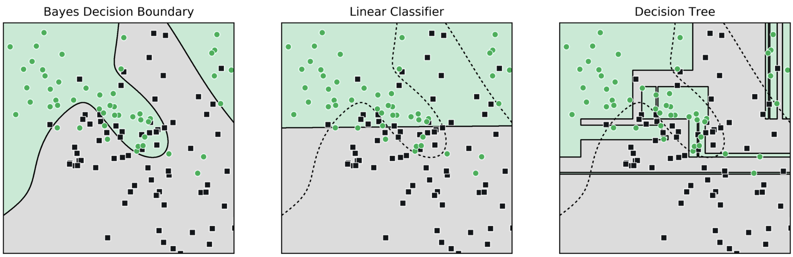

<!--
  Interactive classifier demo for the homepage (included by index.qmd).

  What it does: you pick a dataset and a classifier (k-nearest neighbors, a decision tree, or
  logistic regression), turn the model's complexity knob, and watch the decision boundary and the
  training vs. test accuracy change. The demo opens deliberately overfit (k-NN with k = 1).

  How this file is organized:
    1. A static fallback figure (plain Quarto markdown). It shows until the demo starts, and stays
       visible if JavaScript is turned off or the demo hits an error.
    2. One raw HTML block containing
         a. the demo's HTML (the plot canvas and the controls),
         b. its CSS (every rule is scoped under #ml-demo, so it can't affect the rest of the site),
         c. its JavaScript: data generation, the three ML models, and the drawing code.
  Everything runs in the browser, with no libraries and no network requests.
-->

::: {#ml-demo-fallback}
{fig-alt="Three panels comparing classifiers on the same two-class dataset: the Bayes decision boundary, a linear classifier, and a decision tree."}
:::

```{=html}
<!-- The demo starts hidden; the script un-hides it once everything is ready.
     Elements the script uses are tagged with data-* attributes:
       data-group   a row of toggle buttons where one is selected at a time
       data-value   the value a toggle button selects
       data-input   a slider or checkbox the script reads
       data-out     text the script writes (accuracies, slider label, hint)
       data-action  a one-shot button (new samples, clear points) -->
<div id="ml-demo" hidden>
  <p class="mld-caption"><strong>Try it yourself:</strong> each shaded region is the model's guess. Click the plot to add points, then move the slider and compare training vs. test accuracy.</p>
  <div class="mld-layout">
    <!-- Left (or top on phones): the plot and the accuracy readout -->
    <div class="mld-plot">
      <!-- Axis labels sit outside the canvas: the y-axis label in a narrow left column and the
           x-axis label underneath. Both axes are input FEATURES (x1 and x2); the class label is
           shown by color and shape. They're named x1 and x2 rather than x and y because in ML,
           y usually means the label. The subscripts are Unicode characters rather than <sub>
           tags, because <sub> renders as a superscript in rotated (vertical) text. -->
      <div class="mld-axes">
        <span class="mld-axis-y" aria-hidden="true">Feature x₂</span>
        <canvas role="img" aria-label="Interactive classifier plot"></canvas>
        <span class="mld-axis-x" aria-hidden="true">Feature x₁</span>
      </div>
      <p class="mld-readout" aria-live="polite">
        Training accuracy: <strong data-out="train">—</strong> · Test accuracy: <strong data-out="test">—</strong>
      </p>
    </div>
    <!-- Right (or below on phones): the controls -->
    <div class="mld-controls">
      <fieldset>
        <legend>Dataset</legend>
        <div class="mld-seg" data-group="dataset">
          <button type="button" data-value="blobs">Blobs</button>
          <button type="button" data-value="moons">Moons</button>
          <button type="button" data-value="circles">Circles</button>
          <button type="button" data-value="xor">XOR</button>
        </div>
        <label class="mld-range">Noise
          <input type="range" data-input="noise" min="0" max="1" step="0.05" value="0.8">
        </label>
        <div class="mld-actions">
          <button type="button" data-action="new-train">New training sample</button>
          <button type="button" data-action="new-test">New test sample</button>
        </div>
      </fieldset>
      <fieldset>
        <legend>Model</legend>
        <div class="mld-seg" data-group="model">
          <button type="button" data-value="knn">k-Nearest Neighbors</button>
          <button type="button" data-value="tree">Decision tree</button>
          <button type="button" data-value="lr">Logistic regression</button>
        </div>
        <!-- The complexity slider. Its label, range, and hint change with the selected model. -->
        <label class="mld-range"><span><span data-out="param-label">Neighbors k</span>: <output data-out="param-value">1</output></span>
          <input type="range" data-input="param" min="1" max="30" step="1" value="1">
        </label>
        <p class="mld-hint" data-out="hint"></p>
      </fieldset>
      <fieldset>
        <legend>Your points</legend>
        <div class="mld-seg" data-group="addClass" role="group" aria-label="Clicks add">
          <button type="button" data-value="1"><span class="mld-swatch mld-swatch-a" aria-hidden="true"></span>Add class A</button>
          <button type="button" data-value="0"><span class="mld-swatch mld-swatch-b" aria-hidden="true"></span>Add class B</button>
        </div>
        <button type="button" class="mld-btn" data-action="clear">Clear points</button>
        <label class="mld-check"><input type="checkbox" data-input="showTest" checked> Show test points (hollow)</label>
      </fieldset>
    </div>
  </div>
</div>

<style>
#ml-demo {
  /* Colors sampled from img/decision-boundaries.png. The script reads these values, so the
     plot can be recolored here without touching any JavaScript. */
  --mld-region-a: #c2ead4;
  --mld-region-b: #dcdcdc;
  --mld-neutral: #f4f5f4;
  --mld-point-a: #06b050;
  --mld-point-b: #121619;
  --mld-point-edge: #ffffff;
  --mld-boundary: #000000;
  --mld-accent: #2e7d4f;
  /* Lets the layout below respond to the demo's own width rather than the whole window's */
  container-type: inline-size;
  margin: 1.25rem 0 1.5rem;
}
#ml-demo .mld-caption { margin-bottom: 0.75rem; }
/* One column by default; plot and controls side by side when there's room */
#ml-demo .mld-layout { display: grid; gap: 1.25rem; grid-template-columns: minmax(0, 1fr); }
@container (min-width: 620px) {
  #ml-demo .mld-layout { grid-template-columns: minmax(0, 1.6fr) minmax(200px, 1fr); align-items: start; }
}
/* The plot is always square and fills its column */
#ml-demo canvas {
  display: block; width: 100%; height: auto; aspect-ratio: 1;
  cursor: crosshair; touch-action: manipulation;
  border: 1px solid #b5b5b5;
}
/* Axis labels: a left column for the vertical label (rotated to read bottom to top) and a
   row under the plot for the horizontal one */
#ml-demo .mld-axes { display: grid; grid-template-columns: auto minmax(0, 1fr); align-items: center; column-gap: 0.3rem; }
#ml-demo .mld-axis-x, #ml-demo .mld-axis-y { font-size: 0.8rem; line-height: 1; opacity: 0.75; white-space: nowrap; }
#ml-demo .mld-axis-y { writing-mode: vertical-rl; transform: rotate(180deg); }
#ml-demo .mld-axis-x { grid-column: 2; text-align: center; margin-top: 0.3rem; }
#ml-demo .mld-readout { margin: 0.5rem 0 0; font-size: 0.95rem; }
/* Control groups: small uppercase headings, no boxes */
#ml-demo fieldset { border: 0; margin: 0 0 1rem; padding: 0; min-width: 0; }
#ml-demo legend {
  float: none; width: auto; margin-bottom: 0.35rem; padding: 0;
  font-size: 0.8rem; font-weight: 600; letter-spacing: 0.04em; text-transform: uppercase; opacity: 0.75;
}
/* Buttons: outlined, and filled in when selected (aria-pressed="true") */
#ml-demo .mld-seg, #ml-demo .mld-actions { display: flex; flex-wrap: wrap; gap: 0.35rem; margin-bottom: 0.5rem; }
#ml-demo button {
  font: inherit; font-size: 0.875rem; line-height: 1.2;
  padding: 0.35rem 0.65rem; border-radius: 0.3rem;
  border: 1px solid var(--mld-accent); background: transparent; color: var(--mld-accent);
  cursor: pointer;
}
#ml-demo button:hover { background: rgba(46, 125, 79, 0.08); }
#ml-demo button[aria-pressed="true"] { background: var(--mld-accent); color: #fff; }
#ml-demo button:focus-visible, #ml-demo input:focus-visible { outline: 2px solid var(--mld-accent); outline-offset: 2px; }
/* Sliders and the checkbox */
#ml-demo .mld-range { display: flex; flex-direction: column; gap: 0.2rem; margin: 0.25rem 0 0.5rem; font-size: 0.875rem; }
#ml-demo input[type="range"] { width: 100%; accent-color: var(--mld-accent); }
#ml-demo .mld-check { display: flex; align-items: center; gap: 0.4rem; margin-top: 0.5rem; font-size: 0.875rem; }
#ml-demo input[type="checkbox"] { accent-color: var(--mld-accent); }
#ml-demo .mld-hint { margin: 0; font-size: 0.85rem; opacity: 0.8; }
/* The small circle and square on the "Add class" buttons */
#ml-demo .mld-swatch { display: inline-block; width: 0.7em; height: 0.7em; margin-right: 0.4em; vertical-align: -0.05em; border: 1px solid #fff; }
#ml-demo .mld-swatch-a { background: var(--mld-point-a); border-radius: 50%; }
#ml-demo .mld-swatch-b { background: var(--mld-point-b); }
</style>

<script>
// =====================================================================================
// HOW TO READ THIS SCRIPT (a quick JavaScript guide for Python users)
//
//   var x = 5;                     is like   x = 5
//   function f(a, b) { ... }       is like   def f(a, b): ...
//   for (i = 0; i < n; i++)        is like   for i in range(n):
//   cond ? a : b                   is like   a if cond else b
//   [1, 2, 3]  and  { x: 1 }       are like  a list and a dict
//   pts.push(p)                    is like   pts.append(p)
//   new Float64Array(n)            is like   np.zeros(n)  (a fixed-size array of floats)
//
// The ML code follows scikit-learn's fit/predict idea, with one twist: each fit function
// RETURNS a predict function. That returned function "remembers" the fitted parameters
// (the stored neighbors, the tree, or the weights), the way a fitted sklearn model object
// remembers its coef_ or tree_.
//
// Sections, in order:
//   1. Random data ............. seeded random numbers and the four toy datasets
//   2. Models .................. k-NN, decision tree, logistic regression (fit + predict)
//   3. State ................... the current settings (dataset, model, seeds, and so on)
//   4. Fitting and evaluation .. train the model, measure accuracy, map the decision boundary
//   5. Drawing ................. paint the plot on the canvas
//   6. Events .................. respond to buttons, sliders, and clicks
//
// Everything is wrapped in one function that runs immediately, so none of these variables
// leak into the rest of the web page.
// =====================================================================================
(function () {
  "use strict";
  var root = document.getElementById("ml-demo");
  var fallback = document.getElementById("ml-demo-fallback");
  if (!root) return;

  // If anything goes wrong, hide the demo and show the static figure instead, so the page
  // never ends up broken.
  function fail(err) {
    root.hidden = true;
    if (fallback) fallback.hidden = false;
    if (window.console) console.error("ML demo disabled:", err);
  }

  // =====================================================================================
  // 1. RANDOM DATA
  // =====================================================================================

  // A seeded pseudo-random number generator ("mulberry32"). JavaScript's built-in Math.random()
  // can't be seeded, but ML experiments need reproducibility: the same seed must always produce
  // the same dataset (like np.random.default_rng(seed) in Python). Each call to the returned
  // function gives a new number uniformly distributed between 0 and 1. The bit manipulation
  // below is just a fast way to scramble the seed; you don't need it to follow the ML.
  function mulberry32(seed) {
    return function () {
      seed |= 0; seed = (seed + 0x6D2B79F5) | 0;
      var t = Math.imul(seed ^ (seed >>> 15), 1 | seed);
      t = (t + Math.imul(t ^ (t >>> 7), 61 | t)) ^ t;
      return ((t ^ (t >>> 14)) >>> 0) / 4294967296;
    };
  }
  // One draw from a standard normal distribution N(0, 1), built from two uniform draws
  // (the Box-Muller transform). Using 1 - rand() keeps u above 0, so log(u) is never log(0).
  function gaussian(rand) {
    var u = 1 - rand(), v = rand();
    return Math.sqrt(-2 * Math.log(u)) * Math.cos(2 * Math.PI * v);
  }
  // Limit v to the range [lo, hi].
  function clamp(v, lo, hi) { return Math.max(lo, Math.min(hi, v)); }

  // Sizes of the two datasets. The model learns from the training set. The test set is held
  // out and used only to measure how well the model does on data it has never seen.
  var N_TRAIN = 140, N_TEST = 60;

  // The four toy datasets (similar to scikit-learn's make_blobs, make_moons, and make_circles).
  // Each generator draws ONE point for class c (1 = class A, drawn as green circles;
  // 0 = class B, drawn as black squares) at noise level s between 0 and 1. All datasets live
  // in the square -1 <= x, y <= 1.
  //
  // Naming note: throughout this code, x and y are the point's two input FEATURES (labeled
  // "Feature x1" and "Feature x2" on the plot), not an input and an output. The class label,
  // which is what ML usually calls y, is stored separately as c.
  //
  // "Noise" sets the standard deviation (sd) of random Gaussian jitter added to each point.
  // More noise means the two classes overlap more, so even the best possible classifier makes
  // some mistakes (that unavoidable error is called the Bayes error). Overlap is also what makes
  // overfitting hurt: a model that bends its boundary around every noisy point is learning the
  // noise, not the underlying pattern.
  var GENERATORS = {
    // Two round clouds: class A centered at (-0.4, 0.35), class B at (0.4, -0.35).
    blobs: function (c, s, rand) {
      var sd = 0.1 + 0.4 * s, cx = c ? -0.4 : 0.4, cy = c ? 0.35 : -0.35;
      return { x: cx + sd * gaussian(rand), y: cy + sd * gaussian(rand) };
    },
    // Two interlocking half circles. Pick a random angle t along the arc, take that point on
    // class A's upper arc or class B's lower arc, add noise, then shift and shrink everything
    // to fit inside the square.
    moons: function (c, s, rand) {
      var t = Math.PI * rand(), sd = 0.05 + 0.35 * s, x, y;
      if (c) { x = Math.cos(t); y = Math.sin(t); } else { x = 1 - Math.cos(t); y = 0.5 - Math.sin(t); }
      x += sd * gaussian(rand); y += sd * gaussian(rand);
      return { x: (x - 0.5) / 1.75, y: (y - 0.25) / 1.75 };
    },
    // Class A on a small ring (radius 0.35) inside class B's larger ring (radius 0.8).
    // No straight line can separate these, so this dataset shows why logistic regression
    // needs polynomial features to handle curved boundaries.
    circles: function (c, s, rand) {
      var t = 2 * Math.PI * rand(), sd = 0.03 + 0.25 * s, r = c ? 0.35 : 0.8;
      return { x: r * Math.cos(t) + sd * gaussian(rand), y: r * Math.sin(t) + sd * gaussian(rand) };
    },
    // Four clusters at the corners of a square. Class A sits top-right and bottom-left; class B
    // top-left and bottom-right. As with XOR in logic, the class depends on whether x and y have
    // the same sign. sx picks left or right at random; sy is then set from sx and the class.
    xor: function (c, s, rand) {
      var sd = 0.08 + 0.3 * s, sx = rand() < 0.5 ? -1 : 1, sy = c ? sx : -sx;
      return { x: 0.45 * sx + sd * gaussian(rand), y: 0.45 * sy + sd * gaussian(rand) };
    }
  };

  // Draw a dataset of count points, alternating class A and class B so the classes are exactly
  // balanced. Each point is a small object {x, y, c}, where c is the label (1 = A, 0 = B).
  //
  // The training and test sets are drawn SEPARATELY, each from its own seed, but from the same
  // distribution (same dataset and noise level). That's the key assumption behind a test set:
  // it comes from the same process as the training data, so accuracy on it estimates how the
  // model will do on new data. Separate seeds also let you redraw either set on its own.
  //
  // Points are clamped to stay just inside the plot, so none are drawn off the edge.
  function generate(name, noise, seed, count) {
    var rand = mulberry32(seed), pts = [];
    for (var i = 0; i < count; i++) {
      var c = i % 2, p = GENERATORS[name](c, noise, rand);
      pts.push({ x: clamp(p.x, -0.98, 0.98), y: clamp(p.y, -0.98, 0.98), c: c });
    }
    return pts;
  }

  // =====================================================================================
  // 2. MODELS
  //
  // Every model follows the same pattern:
  //     predict = fitSomething(train, param)
  //     predict(x, y)  ->  estimated probability that the point (x, y) is class A
  //
  // A point is classified as class A when that probability is above 0.5, and as class B
  // otherwise. The DECISION BOUNDARY is the curve where the probability is exactly 0.5.
  //
  // Each model has one "complexity knob" (param), set by the slider:
  //   k-NN                  k, the number of neighbors   (SMALLER k = more complex)
  //   decision tree         maximum depth                (DEEPER = more complex)
  //   logistic regression   polynomial degree            (HIGHER = more complex)
  // Too little complexity underfits (misses the real pattern). Too much overfits (memorizes the
  // noise in the training data, which shows up as high training accuracy but lower test accuracy).
  // =====================================================================================

  // ---- k-nearest neighbors (like sklearn's KNeighborsClassifier) ----
  //
  // k-NN is a "lazy" learner: fitting does no real work, it just stores the training points.
  // The work happens at prediction time. To classify a new point, find the k training points
  // closest to it and let them vote. The predicted probability of class A is the fraction of
  // those k neighbors that are class A.
  //
  // With k = 1, every training point is its own nearest neighbor, so training accuracy is 100%
  // (unless two points of different classes sit at exactly the same spot) and the boundary bends
  // around every single point: classic overfitting. Larger k averages over more neighbors,
  // which smooths the boundary. Very large k smooths away real structure (underfitting).
  function fitKnn(train, k) {
    var n = train.length, i;
    // k can't be larger than the number of training points.
    k = Math.min(k, n);
    // "Fitting": copy the coordinates and labels into compact arrays for fast access.
    var xs = new Float64Array(n), ys = new Float64Array(n), cs = new Uint8Array(n);
    for (i = 0; i < n; i++) { xs[i] = train[i].x; ys[i] = train[i].y; cs[i] = train[i].c; }
    // Scratch space reused by every prediction: the k smallest distances found so far (bestD)
    // and the labels of those points (bestC), kept sorted from nearest to farthest.
    var bestD = new Float64Array(k), bestC = new Uint8Array(k);
    return function (x, y) {
      var m = 0, i, j;
      // Check the distance to every training point (brute force is fine for a few hundred points).
      for (i = 0; i < n; i++) {
        // Squared Euclidean distance. The square root is skipped because it doesn't change
        // which points are closest, and skipping it saves time.
        var dx = xs[i] - x, dy = ys[i] - y, d = dx * dx + dy * dy;
        // Maintain the sorted list of the k nearest points so far (an insertion sort):
        //   - until k points have been seen, every point is added;
        //   - after that, a point is added only if it's closer than the current k-th nearest,
        //     which then drops off the end of the list.
        if (m < k) j = m++;
        else if (d < bestD[k - 1]) j = k - 1;
        else continue;
        // Shift farther points down one slot until this point's sorted position is found.
        while (j > 0 && bestD[j - 1] > d) { bestD[j] = bestD[j - 1]; bestC[j] = bestC[j - 1]; j--; }
        bestD[j] = d; bestC[j] = cs[i];
      }
      // The vote: count how many of the k neighbors are class A (label 1).
      var a = 0;
      for (j = 0; j < k; j++) a += bestC[j];
      var p = a / k;
      // A tie (possible when k is even) leaves p at exactly 0.5, right on the boundary.
      if (p === 0.5) p += bestC[0] ? 0.01 : -0.01; // break ties with the nearest neighbor
      return p;
    };
  }

  // ---- Decision tree (like sklearn's DecisionTreeClassifier with criterion="gini") ----
  //
  // A decision tree asks a series of yes/no questions such as "is x <= 0.12?". Each answer
  // sends a point left or right until it reaches a leaf, which predicts the fraction of class A
  // among the training points that ended up in that leaf. Every question cuts the plane with a
  // vertical or horizontal line, which is why tree boundaries look like staircases.
  //
  // The tree is grown greedily from the top down (the CART algorithm): at each node, try every
  // possible cut and keep the one that makes the two sides as "pure" (single-class) as possible.
  // Then repeat on each side, until a side is pure or the maximum depth is reached. A deep tree
  // can carve out tiny regions around individual noisy points: overfitting.

  // Gini impurity measures how mixed a group is. For a group where a fraction p is class A:
  //     Gini = 1 - p^2 - (1 - p)^2 = 2 p (1 - p)
  // It's 0 for a pure group and 0.5 for a 50/50 mix. Here a is the number of class A points
  // and n the group size, and the function returns n * Gini (impurity weighted by size), so a
  // split's score is simply  n_left * Gini_left + n_right * Gini_right  (lower is better).
  function gini(a, n) { var p = a / n; return n * 2 * p * (1 - p); }

  function fitTree(train, maxDepth) {
    // Grow the tree recursively. pts are the training points that reached this node, and depth
    // counts how many questions were asked to get here (the root has depth 0).
    function build(pts, depth) {
      // Count the class A points (a) out of the n points here.
      var n = pts.length, a = 0, i;
      for (i = 0; i < n; i++) a += pts[i].c;
      // If growth stops here, this node becomes a leaf predicting the fraction of class A.
      var leaf = { p: a / n };
      // Stopping rules: the depth limit is reached, or the node is already pure (one class only).
      if (depth >= maxDepth || a === 0 || a === n) return leaf;
      // Search both features (x and y) for the best single cut.
      var best = null;
      ["x", "y"].forEach(function (f) {
        // Sort the points by this feature. The candidate cuts lie between neighboring values,
        // so walking along the sorted list visits every possible split exactly once.
        // la counts the class A points on the left side as the cut moves to the right.
        var s = pts.slice().sort(function (u, v) { return u[f] - v[f]; }), la = 0;
        for (var i = 0; i < n - 1; i++) {
          // Move point i onto the left side of the cut.
          la += s[i].c;
          // There's no gap to cut between two points with the same value.
          if (s[i][f] === s[i + 1][f]) continue;
          // Score this split: the left side has ln points (la of them class A); the right has
          // the remaining n - ln points (a - la of them class A).
          var ln = i + 1, g = gini(la, ln) + gini(a - la, n - ln);
          // Keep the lowest-impurity split seen so far. The threshold sits halfway between
          // the two neighboring values, as in scikit-learn.
          if (!best || g < best.g) best = { g: g, f: f, t: (s[i][f] + s[i + 1][f]) / 2 };
        }
      });
      // No valid cut exists (every point here has identical coordinates), so make a leaf.
      if (!best) return leaf;
      // Divide the points using the best question, then grow each side the same way.
      // There's no "minimum improvement" rule: an impure node below the depth limit always
      // splits if it can. Only purity or the depth limit stops the growth.
      var left = [], right = [];
      for (i = 0; i < n; i++) (pts[i][best.f] <= best.t ? left : right).push(pts[i]);
      // An internal node stores its question (feature f and threshold t) and its two children.
      return { f: best.f, t: best.t, l: build(left, depth + 1), r: build(right, depth + 1) };
    }
    var tree = build(train, 0);
    // To predict, start at the root and follow the answers down to a leaf.
    // (Leaves have no f property, so the loop stops when it reaches one.)
    return function (x, y) {
      var node = tree;
      while (node.f) node = (node.f === "x" ? x : y) <= node.t ? node.l : node.r;
      return node.p;
    };
  }

  // ---- Logistic regression (like sklearn's LogisticRegression on PolynomialFeatures) ----
  //
  // Logistic regression computes a weighted sum of features,
  //     z = w0 * 1 + w1 * f1(x, y) + w2 * f2(x, y) + ...
  // and squashes it into a probability with the sigmoid function: p = sigmoid(z).
  // Since p > 0.5 exactly when z > 0, the decision boundary is the curve z = 0.
  //
  // With degree 1 the features are just 1, y, and x, so z = 0 is a straight line.
  // Higher degrees add products such as x^2, x*y, y^2, x^3, and so on. The model is still
  // LINEAR IN ITS WEIGHTS, but in terms of x and y the boundary z = 0 can now curve: degree 2
  // can draw circles and ellipses, and higher degrees can wiggle. That's how a "linear" model
  // can fit the Circles data.

  // The sigmoid (logistic) function, sigmoid(z) = 1 / (1 + e^(-z)), maps any number into (0, 1).
  // It's written two ways so that e^(...) is never computed for a large positive number,
  // which could overflow to infinity.
  function sigmoid(z) {
    if (z >= 0) return 1 / (1 + Math.exp(-z));
    var e = Math.exp(z);
    return e / (1 + e);
  }

  function fitLogistic(train, degree) {
    // ---- Step 1: polynomial feature expansion ----
    // List every monomial x^i * y^j with i + j <= degree, stored as [i, j] pairs. For degree 2
    // that's [0,0] [0,1] [1,0] [0,2] [1,1] [2,0], meaning 1, y, x, y^2, xy, x^2. The first one,
    // x^0 * y^0 = 1, is the bias (intercept) term. There are (degree + 1)(degree + 2) / 2
    // features in total: 3 for degree 1, 28 for degree 6.
    var powers = [], t, i;
    for (t = 0; t <= degree; t++) for (i = 0; i <= t; i++) powers.push([i, t - i]);
    var m = powers.length, n = train.length;
    // features() computes one point's m features and writes them into out[offset], out[offset + 1],
    // and so on. Powers are built by repeated multiplication (xp[d] holds x^d), which is cheaper
    // than calling Math.pow. No feature scaling is needed: every point lies between -1 and 1,
    // so every monomial does too.
    var xp = new Float64Array(degree + 1), yp = new Float64Array(degree + 1);
    function features(x, y, out, offset) {
      xp[0] = yp[0] = 1;
      for (var d = 1; d <= degree; d++) { xp[d] = xp[d - 1] * x; yp[d] = yp[d - 1] * y; }
      for (var f = 0; f < m; f++) out[offset + f] = xp[powers[f][0]] * yp[powers[f][1]];
    }
    // The design matrix X (n rows by m feature columns, stored row after row in one flat array,
    // like a flattened NumPy array) and the label vector Y (1 = class A, 0 = class B).
    var X = new Float64Array(n * m), Y = new Float64Array(n);
    for (i = 0; i < n; i++) { features(train[i].x, train[i].y, X, i * m); Y[i] = train[i].c; }

    // ---- Step 2: learn the weights ----
    // Training minimizes the average cross-entropy (log) loss plus a small L2 penalty:
    //     L(w) = -(1/n) * sum_i [ y_i * log(p_i) + (1 - y_i) * log(1 - p_i) ]  +  (l2 / 2) * |w|^2
    // where p_i = sigmoid(w . features_i). The gradient has a famously simple form:
    //     dL/dw = (1/n) * sum_i (p_i - y_i) * features_i  +  l2 * w
    // In words: each training point pushes the weights in proportion to its prediction error.
    //
    // The weights move downhill along that gradient using Adam, a version of gradient descent
    // that's popular in deep learning because it adapts the step size for each weight.
    // "Full batch" means every step uses all n training points.
    //   - lr (the learning rate) is the base step size; b1 and b2 control Adam's running averages.
    //   - l2 is a small ridge penalty that stops the weights from growing without limit when the
    //     classes can be perfectly separated. The bias w0 is not penalized. In scikit-learn terms
    //     this is roughly C = 1 / (n * l2), about 70, which is weak regularization.
    //   - iters = 800 steps, starting from all-zero weights, so the same data always gives the
    //     same model. Stopping after a fixed number of steps also acts as mild regularization
    //     ("early stopping"): high-degree fits don't get enough steps to chase every noisy point.
    // w holds the weights; mo and ve are Adam's running averages of the gradient and of its
    // square; g accumulates the gradient on each step.
    var w = new Float64Array(m), mo = new Float64Array(m), ve = new Float64Array(m), g = new Float64Array(m);
    var lr = 0.05, b1 = 0.9, b2 = 0.999, l2 = 1e-4, iters = 800, it, f;
    for (it = 1; it <= iters; it++) {
      // Accumulate sum_i (p_i - y_i) * features_i over all training points.
      g.fill(0);
      for (i = 0; i < n; i++) {
        // z = w . features_i, the model's raw score for point i
        var z = 0, row = i * m;
        for (f = 0; f < m; f++) z += w[f] * X[row + f];
        // The prediction error: predicted probability minus the true label (between -1 and 1).
        var err = sigmoid(z) - Y[i];
        for (f = 0; f < m; f++) g[f] += err * X[row + f];
      }
      for (f = 0; f < m; f++) {
        // The average gradient, plus the L2 penalty's gradient (skipped for the bias, f = 0).
        var grad = g[f] / n + (f ? l2 * w[f] : 0);
        // Adam's running averages: mo smooths the gradient (momentum), ve tracks its typical size.
        mo[f] = b1 * mo[f] + (1 - b1) * grad;
        ve[f] = b2 * ve[f] + (1 - b2) * grad * grad;
        // Step the weight downhill. Dividing by sqrt(ve) makes every weight move at a similar
        // rate, and the (1 - b^it) terms correct the averages' bias toward zero in early steps.
        w[f] -= lr * (mo[f] / (1 - Math.pow(b1, it))) / (Math.sqrt(ve[f] / (1 - Math.pow(b2, it))) + 1e-8);
      }
    }
    // To predict: expand the point into the same features, take the weighted sum, apply sigmoid.
    var phi = new Float64Array(m);
    return function (x, y) {
      features(x, y, phi, 0);
      var z = 0;
      for (var f = 0; f < m; f++) z += w[f] * phi[f];
      return sigmoid(z);
    };
  }

  // The three models, with each one's slider range, its starting value (init), and the hint
  // shown under the slider. k-NN starts at k = 1 on purpose (see the State section below).
  var MODELS = {
    knn: { fit: fitKnn, label: "Neighbors k", min: 1, max: 30, init: 1,
           hint: "Small k gives a wiggly boundary that memorizes the training points; large k smooths it out." },
    tree: { fit: fitTree, label: "Max depth", min: 1, max: 10, init: 4,
            hint: "Each level splits the plane with another horizontal or vertical cut." },
    lr: { fit: fitLogistic, label: "Polynomial degree", min: 1, max: 6, init: 1,
          hint: "Degree 1 is a straight line; higher degrees let the boundary curve." }
  };
  // Display names used in the plot's description for screen readers.
  var DATASET_NAMES = { blobs: "Blobs", moons: "Moons", circles: "Circles", xor: "XOR" };
  var MODEL_NAMES = { knn: "k-nearest neighbors", tree: "decision tree", lr: "logistic regression" };

  // How finely to sample the plane when mapping the decision boundary (a G by G grid of cells).
  // A finer grid draws a more accurate picture but needs more model predictions per redraw:
  //   - a tree is cheap to evaluate (a few comparisons per point), so it gets a fine grid;
  //   - logistic regression costs one weighted sum of up to 28 features per point;
  //   - k-NN is the most expensive (a distance to every training point), so its grid shrinks
  //     as the training set grows.
  // Together this keeps each redraw to roughly 20 ms on a laptop.
  function gridSize(model, nTrain) {
    if (model === "tree") return 300;
    if (model === "lr") return 200;
    return clamp(Math.round(Math.sqrt(1.5e6 / Math.max(nTrain, 1))), 60, 110);
  }

  // =====================================================================================
  // 3. STATE: everything the user can change lives in one object
  //
  //   dataset, model         which dataset and classifier are selected
  //   noise                  the noise slider, from 0 to 1
  //   trainSeed, testSeed    the random seeds for the two samples
  //   addClass               which class a click on the plot adds (1 = A, 0 = B)
  //   showTest               whether the hollow test points are drawn
  //   params                 each model's slider value, remembered when you switch models
  //   data                   the generated points, as { train: [...], test: [...] }
  //   custom                 points you've added by clicking; they join the TRAINING set
  //   hideTrain, hideTest    set by "Clear points" to remove the generated points
  // =====================================================================================
  // The page opens overfit on purpose: 1-NN memorizes the training set (100%, with islands around
  // single points) but scores 85% on test. Moving k up raises test accuracy almost steadily to 93% at
  // k = 15, where training and test agree. High noise (0.8) makes the lesson reliable: averaged over
  // 60 random draws, k = 15 beats k = 1 on test by about 5 points and wins in about 3 of 4 draws.
  // Seeds 3 (training) and 7 (test) give a typical draw with a slightly clearer than average gain.
  var state = {
    dataset: "moons", model: "knn", noise: 0.8, trainSeed: 3, testSeed: 7, addClass: 1, showTest: true,
    params: { knn: MODELS.knn.init, tree: MODELS.tree.init, lr: MODELS.lr.init },
    data: null, custom: [], hideTrain: false, hideTest: false
  };
  // predict: the currently fitted model (null when it can't be fit, e.g. only one class present).
  // grid: the model's predictions over the plane plus the boundary line, ready to draw.
  // dirty: which work is out of date, so data is regenerated and the model refit only when needed.
  var predict = null, grid = null, dirty = { data: true, fit: true };

  // The training set the model learns from: the generated training points plus any you've added.
  function trainingSet() {
    return (state.hideTrain ? [] : state.data.train).concat(state.custom);
  }
  // The held-out test set. It's used ONLY to measure accuracy, never to fit the model.
  function testSet() { return state.hideTest ? [] : state.data.test; }

  // A fresh random seed that differs from the other sample's seed. (With identical seeds, the
  // test set would just be a copy of the first 60 training points.)
  function newSeed(avoid) {
    var s;
    do { s = Math.floor(Math.random() * 1e9); } while (s === avoid);
    return s;
  }

  // ---------- Page plumbing: find the canvas and controls ----------
  // ctx is the canvas's 2D drawing interface. off is a small hidden canvas used to build the
  // background shading image before it's stretched onto the visible canvas.
  var canvas = root.querySelector("canvas");
  var ctx = canvas.getContext && canvas.getContext("2d");
  if (!ctx) { fail("2D canvas not supported"); return; }
  var off = document.createElement("canvas"), offCtx = off.getContext("2d");
  // out and inputs look up page elements by their data-out and data-input names from the HTML.
  var out = {};
  root.querySelectorAll("[data-out]").forEach(function (el) { out[el.getAttribute("data-out")] = el; });
  var inputs = {};
  root.querySelectorAll("[data-input]").forEach(function (el) { inputs[el.getAttribute("data-input")] = el; });
  // css: plot colors read from the stylesheet; cssW: canvas width in CSS pixels;
  // dpr: the screen's pixel density (device pixels per CSS pixel).
  var css = {}, cssW = 0, dpr = 1;

  // Read the plot colors from the CSS custom properties, so colors are defined in one place.
  // The three background colors are also converted to [red, green, blue] numbers (0 to 255),
  // which are needed to build the shading image pixel by pixel.
  function readColors() {
    var cs = getComputedStyle(root);
    ["region-a", "region-b", "neutral", "point-a", "point-b", "point-edge", "boundary"].forEach(function (k) {
      css[k] = cs.getPropertyValue("--mld-" + k).trim();
    });
    css.rgb = {};
    ["region-a", "region-b", "neutral"].forEach(function (k) {
      offCtx.fillStyle = css[k];
      var hex = offCtx.fillStyle; // canvas normalizes any CSS color to #rrggbb
      css.rgb[k] = [1, 3, 5].map(function (i) { return parseInt(hex.slice(i, i + 2), 16); });
    });
  }

  // Make the controls match the current state: highlight the selected buttons, and set the
  // slider's range, value, label, and hint for the current model.
  function syncControls() {
    root.querySelectorAll("[data-group]").forEach(function (group) {
      var key = group.getAttribute("data-group");
      group.querySelectorAll("button").forEach(function (b) {
        b.setAttribute("aria-pressed", String(b.getAttribute("data-value") === String(state[key])));
      });
    });
    var meta = MODELS[state.model], p = inputs.param;
    p.min = meta.min; p.max = meta.max; p.value = state.params[state.model];
    out["param-label"].textContent = meta.label;
    out["param-value"].textContent = state.params[state.model];
    out.hint.textContent = meta.hint;
  }

  // =====================================================================================
  // 4. FITTING AND EVALUATION
  // =====================================================================================

  // A classifier needs examples of both classes to learn anything. With only one class present,
  // fitting is skipped and the readout shows a dash.
  function hasBothClasses(pts) {
    var a = 0;
    for (var i = 0; i < pts.length; i++) a += pts[i].c;
    return a > 0 && a < pts.length;
  }

  // Accuracy = the fraction of points whose predicted class matches their true label. The
  // predicted class is A when the model's probability is above 0.5, otherwise B.
  // Returns null when there's no model or no points to score.
  function accuracy(pts) {
    if (!predict || !pts.length) return null;
    var right = 0;
    for (var i = 0; i < pts.length; i++) right += (predict(pts[i].x, pts[i].y) > 0.5 ? 1 : 0) === pts[i].c ? 1 : 0;
    return right / pts.length;
  }

  // The main ML step, run whenever the data, the model, or the slider changes:
  //   1. regenerate the training and test samples if they're out of date,
  //   2. FIT the model, using the training set only,
  //   3. evaluate the fitted model over a grid to map its decision boundary,
  //   4. report training and test accuracy.
  // Notice that the test set never reaches fit(). If it did, test accuracy would stop being an
  // honest estimate of performance on unseen data (a mistake known as data leakage).
  function refit() {
    if (dirty.data) {
      state.data = {
        train: generate(state.dataset, state.noise, state.trainSeed, N_TRAIN),
        test: generate(state.dataset, state.noise, state.testSeed, N_TEST)
      };
      dirty.data = false;
    }
    var train = trainingSet();
    predict = hasBothClasses(train) ? MODELS[state.model].fit(train, state.params[state.model]) : null;
    grid = predict ? evaluateGrid(gridSize(state.model, train.length)) : null;
    dirty.fit = false;
    updateReadout(train);
  }

  // Map the model's predictions across the whole plane. This is the same idea as the usual
  // Python recipe for plotting a decision boundary: build a grid with np.meshgrid, call
  // predict_proba at every grid point, then draw with plt.contourf (shading) and plt.contour (line).
  //
  // The plane from -1 to 1 in each direction is divided into G by G cells, and the model is
  // evaluated at the (G + 1) by (G + 1) cell corners ("nodes"). Node (i, j) is column i and
  // row j, with row 0 at the top: x = -1 + 2i/G and y = 1 - 2j/G (y shrinks going down,
  // as on a graph).
  function evaluateGrid(G) {
    var n = G + 1, vals = new Float64Array(n * n), i, j;
    for (j = 0; j < n; j++) {
      var y = 1 - (2 * j) / G;
      for (i = 0; i < n; i++) vals[j * n + i] = predict(-1 + (2 * i) / G, y);
    }
    // Build the background shading, one pixel per node. Each pixel takes the predicted class's
    // color, faded toward a neutral color where the model is unsure:
    //     confidence t = |p - 0.5| * 2     (0 on the boundary, 1 where the model is certain)
    // Raising it to the power 0.6 makes moderately confident regions easier to see. When drawn,
    // this small image is smoothly stretched to fill the canvas.
    off.width = n; off.height = n;
    var img = offCtx.createImageData(n, n), d = img.data;
    var na = css.rgb.neutral, ra = css.rgb["region-a"], rb = css.rgb["region-b"];
    for (i = 0; i < n * n; i++) {
      var p = vals[i], target = p > 0.5 ? ra : rb, t = Math.pow(Math.abs(p - 0.5) * 2, 0.6);
      d[i * 4] = na[0] + (target[0] - na[0]) * t;
      d[i * 4 + 1] = na[1] + (target[1] - na[1]) * t;
      d[i * 4 + 2] = na[2] + (target[2] - na[2]) * t;
      d[i * 4 + 3] = 255;
    }
    offCtx.putImageData(img, 0, 0);
    return { G: G, vals: vals, segments: contour(vals, G, predict) };
  }

  // Trace the decision boundary (where p = 0.5) as a line, like plt.contour(..., levels=[0.5]).
  //
  // The method is "marching squares". For each grid cell, check which of its four corners are
  // class A (p > 0.5). If the corners disagree, the boundary passes through the cell, crossing
  // each edge whose two ends disagree. Joining those crossing points, cell by cell, traces the line.
  //
  // Where exactly along an edge is the crossing? Many tools interpolate between the corner
  // values, but k-NN and tree probabilities jump in steps, so interpolating would draw a jagged
  // staircase. Instead, this code asks the model itself, halving the edge 8 times (bisection)
  // to find where its prediction flips, to within 1/256 of a cell.
  // Returns a flat list of segment endpoints, in units where the canvas spans 0 to 1.
  function contour(vals, G, predict) {
    var n = G + 1, segs = [], cache = new Map(), i, j;
    // Is the point at grid position (gi, gj) predicted to be class A? (Positions can be fractional.)
    function inside(gi, gj) { return predict(-1 + (2 * gi) / G, 1 - (2 * gj) / G) > 0.5; }
    // Crossing on the edge from node (i0, j0) to its neighbor (i1, j1), in grid units.
    // Results are cached because each edge is shared by two neighboring cells.
    function crossing(i0, j0, i1, j1) {
      var key = (j0 * n + i0) * 2 + (i1 > i0 ? 0 : 1), hit = cache.get(key);
      if (hit) return hit;
      // side: the class at the starting corner. Each halving keeps the half where the flip is.
      var side = vals[j0 * n + i0] > 0.5, lo = 0, hi = 1;
      for (var k = 0; k < 8; k++) {
        var t = (lo + hi) / 2;
        if (inside(i0 + (i1 - i0) * t, j0 + (j1 - j0) * t) === side) lo = t; else hi = t;
      }
      t = (lo + hi) / 2;
      hit = [(i0 + (i1 - i0) * t) / G, (j0 + (j1 - j0) * t) / G];
      cache.set(key, hit);
      return hit;
    }
    for (j = 0; j < G; j++) {
      for (i = 0; i < G; i++) {
        // Record which corners are class A as a 4-bit number: top-left = 8, top-right = 4,
        // bottom-right = 2, bottom-left = 1. A code of 0 or 15 means all four corners agree,
        // so the boundary doesn't pass through this cell.
        var code = (vals[j * n + i] > 0.5 ? 8 : 0) | (vals[j * n + i + 1] > 0.5 ? 4 : 0) |
                   (vals[(j + 1) * n + i + 1] > 0.5 ? 2 : 0) | (vals[(j + 1) * n + i] > 0.5 ? 1 : 0);
        if (code === 0 || code === 15) continue;
        var top = function () { return crossing(i, j, i + 1, j); };
        var right = function () { return crossing(i + 1, j, i + 1, j + 1); };
        var bottom = function () { return crossing(i, j + 1, i + 1, j + 1); };
        var left = function () { return crossing(i, j, i, j + 1); };
        // Each mixed case lists the two edges the boundary crosses. A case and its opposite
        // (such as 1 and 14, where the corners are flipped) cross the same edges.
        switch (code) {
          case 1: case 14: segs.push(left(), bottom()); break;
          case 2: case 13: segs.push(bottom(), right()); break;
          case 3: case 12: segs.push(left(), right()); break;
          case 4: case 11: segs.push(top(), right()); break;
          case 6: case 9: segs.push(top(), bottom()); break;
          case 7: case 8: segs.push(left(), top()); break;
          case 5: case 10:
            // Saddle: the model's prediction at the cell center decides which corners connect
            // (two opposite corners are class A and the other two are class B, so the boundary
            // could pass through the cell in two different ways).
            if (inside(i + 0.5, j + 0.5) === (code === 5)) segs.push(left(), top(), bottom(), right());
            else segs.push(left(), bottom(), top(), right());
            break;
        }
      }
    }
    return segs;
  }

  // Format an accuracy (0 to 1) as a percentage, or as a dash when there's nothing to score.
  function pct(v) { return v === null ? "—" : Math.round(v * 100) + "%"; }

  // Show training and test accuracy, and update the plot's description for screen readers.
  // The gap between the two numbers is the clearest sign of overfitting: a model that has
  // memorized its training data scores high on training but noticeably lower on test.
  function updateReadout(train) {
    var trainAcc = accuracy(train), testAcc = accuracy(testSet());
    out.train.textContent = pct(trainAcc);
    out.test.textContent = pct(testAcc);
    var param = MODELS[state.model].label.toLowerCase() + " " + state.params[state.model];
    canvas.setAttribute("aria-label",
      (state.hideTrain ? "Your own points" : DATASET_NAMES[state.dataset] + " data") +
      ", with feature x1 on the horizontal axis and feature x2 on the vertical axis, classified by " +
      MODEL_NAMES[state.model] + " (" + param + "). Training accuracy " + pct(trainAcc) +
      ", test accuracy " + pct(testAcc) + ".");
  }

  // =====================================================================================
  // 5. DRAWING
  // =====================================================================================

  // Match the canvas's internal pixel count to its on-screen size times the screen's pixel
  // density (2 or 3 on many laptops and phones), so the drawing stays sharp instead of blurry.
  function resize() {
    var w = canvas.clientWidth;
    if (!w) return;
    cssW = w;
    dpr = Math.min(window.devicePixelRatio || 1, 3);
    var px = Math.round(w * dpr);
    if (canvas.width !== px) { canvas.width = px; canvas.height = px; }
    draw();
  }

  // Paint one frame: the shading, then the boundary line, then the points (test points first,
  // so the training points sit on top). Drawing coordinates are in CSS pixels; setTransform
  // scales them up to the canvas's real pixel count.
  function draw() {
    var W = cssW;
    if (!W) return;
    ctx.setTransform(canvas.width / W, 0, 0, canvas.width / W, 0, 0);
    ctx.clearRect(0, 0, W, W);
    if (grid) {
      // Stretch the small shading image over the canvas, offset by half a cell so that each
      // image pixel is centered on its grid node.
      var cell = W / grid.G;
      ctx.imageSmoothingEnabled = true;
      ctx.imageSmoothingQuality = "high";
      ctx.drawImage(off, 0, 0, off.width, off.height, -cell / 2, -cell / 2, W + cell, W + cell);
      // The boundary line, drawn as vector segments so it stays crisp at any zoom level.
      ctx.beginPath();
      for (var s = 0; s < grid.segments.length; s += 2) {
        ctx.moveTo(grid.segments[s][0] * W, grid.segments[s][1] * W);
        ctx.lineTo(grid.segments[s + 1][0] * W, grid.segments[s + 1][1] * W);
      }
      ctx.strokeStyle = css.boundary;
      ctx.lineWidth = 2;
      ctx.lineCap = "round";
      ctx.stroke();
    } else {
      // No model (for example, only one class present): just a plain background.
      ctx.fillStyle = css.neutral;
      ctx.fillRect(0, 0, W, W);
    }
    if (state.showTest) testSet().forEach(function (p) { drawPoint(p, W, true); });
    trainingSet().forEach(function (p) { drawPoint(p, W, false); });
  }

  // Draw one data point. Data coordinates (-1 to 1) become canvas pixels, with y flipped
  // because canvas y grows downward. Class A is a circle and class B a square; training points
  // are filled and test points are hollow.
  function drawPoint(p, W, hollow) {
    var x = ((p.x + 1) / 2) * W, y = ((1 - p.y) / 2) * W, r = Math.max(3.5, W / 110);
    ctx.beginPath();
    if (p.c) ctx.arc(x, y, r, 0, 2 * Math.PI);
    else ctx.rect(x - r * 0.9, y - r * 0.9, r * 1.8, r * 1.8);
    if (hollow) {
      ctx.fillStyle = css["point-edge"];
      ctx.fill();
      ctx.strokeStyle = p.c ? css["point-a"] : css["point-b"];
      ctx.lineWidth = 2;
    } else {
      ctx.fillStyle = p.c ? css["point-a"] : css["point-b"];
      ctx.fill();
      ctx.strokeStyle = css["point-edge"];
      ctx.lineWidth = 1.25;
    }
    ctx.stroke();
  }

  // Coalesce rapid changes (slider drags) into one update per frame.
  // requestAnimationFrame runs the work just before the browser's next screen refresh, so
  // dragging a slider triggers at most one refit per frame instead of dozens.
  // update({ data: true }) regenerates the data and refits; update({}) refits on the same
  // data; update() with no argument only redraws.
  var frame = 0;
  function update(changes) {
    if (changes) { if (changes.data) dirty.data = true; dirty.fit = true; }
    if (frame) return;
    frame = requestAnimationFrame(function () {
      frame = 0;
      try { if (dirty.fit) refit(); draw(); } catch (e) { fail(e); }
    });
  }

  // =====================================================================================
  // 6. EVENTS: connect the buttons, sliders, and clicks to the state
  // =====================================================================================

  // Rows of toggle buttons (dataset, model, and which class a click adds). Switching dataset
  // starts fresh and discards drawn points; switching model just refits on the same data.
  root.querySelectorAll("[data-group]").forEach(function (group) {
    var key = group.getAttribute("data-group");
    group.addEventListener("click", function (e) {
      var b = e.target.closest("button");
      if (!b) return;
      var v = b.getAttribute("data-value");
      if (key === "addClass") { state.addClass = Number(v); syncControls(); return; }
      if (state[key] === v) return;
      state[key] = v;
      if (key === "dataset") { state.custom = []; state.hideTrain = state.hideTest = false; update({ data: true }); }
      else update({});
      syncControls();
    });
  });

  // Noise slider: redraw both samples with the SAME seeds, so the points slide smoothly as the
  // noise changes instead of jumping to a whole new sample.
  inputs.noise.addEventListener("input", function () {
    state.noise = Number(inputs.noise.value);
    update({ data: true });
  });
  // Complexity slider: refit the current model with the new setting.
  inputs.param.addEventListener("input", function () {
    state.params[state.model] = Number(inputs.param.value);
    out["param-value"].textContent = inputs.param.value;
    update({});
  });
  // Show or hide the test points. This only changes the drawing; no refit is needed.
  inputs.showTest.addEventListener("change", function () {
    state.showTest = inputs.showTest.checked;
    update();
  });
  // A new training sample replaces any points you've drawn; the test set stays put
  root.querySelector('[data-action="new-train"]').addEventListener("click", function () {
    state.trainSeed = newSeed(state.testSeed);
    state.custom = []; state.hideTrain = false;
    update({ data: true });
  });
  // A new test sample keeps the training data (including drawn points), so the model is unchanged.
  // Only the test accuracy can move, which shows how much a test score varies just from which
  // points happened to be sampled.
  root.querySelector('[data-action="new-test"]').addEventListener("click", function () {
    state.testSeed = newSeed(state.trainSeed);
    state.hideTest = false;
    update({ data: true });
  });
  // Clear points: hide all generated points so you can build your own training set by clicking.
  // ("New test sample" then brings back a test set to check your model against.)
  root.querySelector('[data-action="clear"]').addEventListener("click", function () {
    state.custom = []; state.hideTrain = state.hideTest = true;
    update({});
  });
  // Clicking the plot adds a training point of the selected class. The click position is
  // converted from screen pixels to data coordinates (-1 to 1, with y pointing up).
  // "click" (not pointerdown) so swiping across the plot to scroll on a phone doesn't add points
  canvas.addEventListener("click", function (e) {
    var r = canvas.getBoundingClientRect();
    var x = ((e.clientX - r.left) / r.width) * 2 - 1, y = 1 - ((e.clientY - r.top) / r.height) * 2;
    state.custom.push({ x: clamp(x, -1, 1), y: clamp(y, -1, 1), c: state.addClass });
    update({});
  });

  // Keep the canvas buffer matched to its displayed size and the screen's pixel density.
  // ResizeObserver reports layout changes; the matchMedia query fires when the pixel density
  // changes (browser zoom, or moving the window to a different screen).
  if (window.ResizeObserver) new ResizeObserver(resize).observe(canvas);
  else window.addEventListener("resize", resize);
  (function watchDpr() {
    if (!window.matchMedia) return;
    var mq = matchMedia("(resolution: " + (window.devicePixelRatio || 1) + "dppx)");
    if (!mq.addEventListener) return;
    mq.addEventListener("change", function () { resize(); watchDpr(); }, { once: true });
  })();

  // ---------- Start ----------
  // Read the colors, set up the controls, show the demo (hiding the static figure), fit the
  // first model, and draw it. Any error falls back to the static figure.
  try {
    readColors();
    syncControls();
    root.hidden = false;
    if (fallback) fallback.hidden = true;
    refit();
    resize();
  } catch (e) {
    fail(e);
  }
})();
</script>
```
